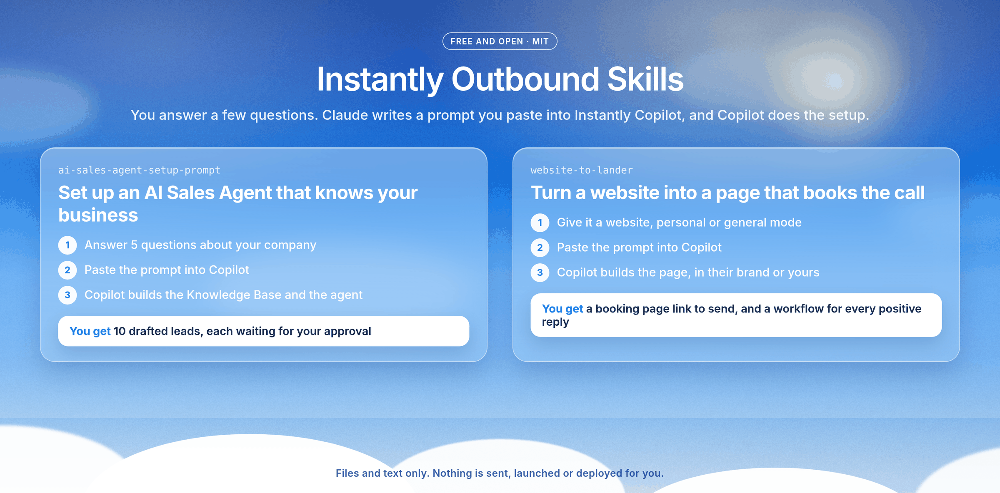
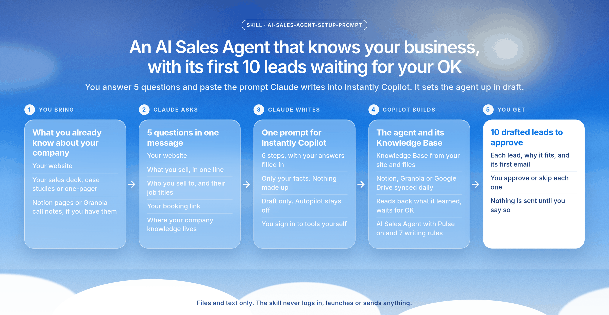
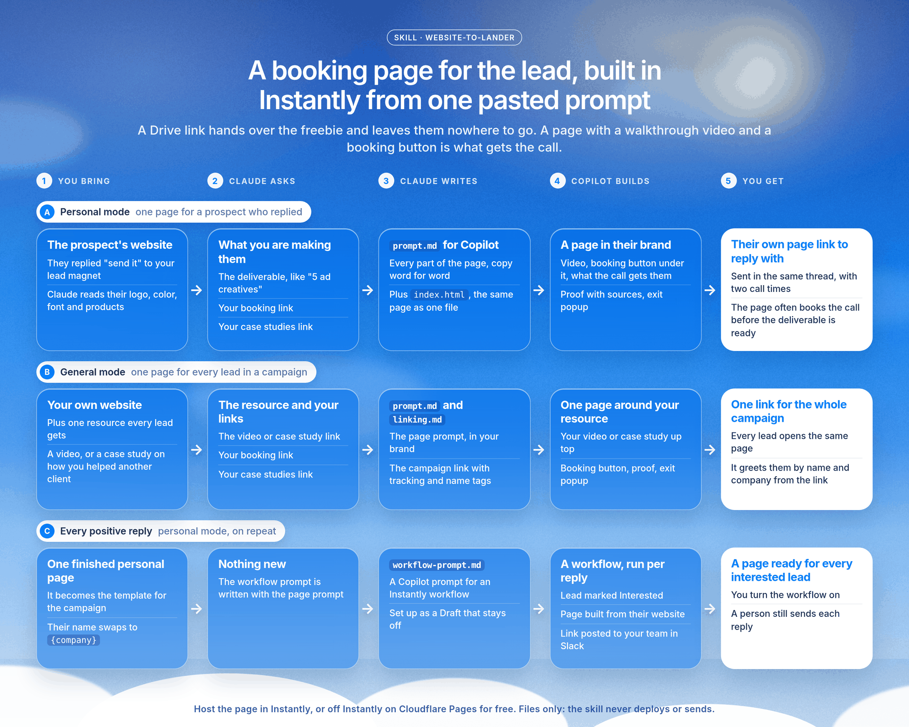

# Instantly Outbound Skills

Free Claude skills that turn a few answers into prompts you paste into Instantly Copilot, so Copilot sets up your AI Sales Agent and builds pages that book calls.



The AI Sales Agent card in the picture still says five questions. The table below is the current flow.

The skills only write text and files on your machine. No API keys, no tracking, and nothing is sent, launched or deployed for you.

## Skills

| Skill | What it does | Use it when | How it works |
|---|---|---|---|
| [ai-sales-agent-setup-prompt](skills/ai-sales-agent-setup-prompt/) | Asks one question at a time until the brief is concrete (who you sell to, the offer, the proof you can stand behind, and what the agent must never say), then writes one Copilot prompt. The prompt builds your Knowledge Base, connects Notion, Granola or Google Drive, and sets up an AI Sales Agent with Pulse on. Its first 10 leads wait for your approval. | You want an AI Sales Agent that writes from your own facts, not guesses. | [See the flow](#ai-sales-agent-setup-prompt) |
| [website-to-lander](skills/website-to-lander/) | Turns a website into a booking page. **Personal:** one page per prospect who replied, in their brand, plus a workflow that builds one for every positive reply. **General:** one page for every lead in a campaign, in your brand, around a video or case study. | A lead magnet campaign gets replies and you want the reply link to book a call. | [See the flow](#website-to-lander) |

## Install

**Claude (claude.ai)**

1. Download this repo (Code, then Download ZIP) and unzip it.
2. Zip just the skill's folder, for example `cd skills && zip -r website-to-lander.zip website-to-lander`.
3. In Claude, open Settings, then Capabilities, and upload the zip under Skills. Skills need to be turned on for your account.

**Claude Code**

```
/plugin marketplace add MitchellkellerLG/Instantly-Outbound-Skills
/plugin install instantly-outbound-skills@instantly-outbound-skills
```

Or copy a skill folder into `~/.claude/skills/`.

**Cowork**

Add the same plugin from this repo's marketplace, or upload the skill zip from the Claude steps above. Then ask for the skill in a new task.

## Quick start

### ai-sales-agent-setup-prompt



The diagram still shows the older five-question card. Follow the steps below.

1. Ask Claude: "Write my AI Sales Agent setup prompt."
2. Answer one question at a time: your website, who you sell to, what you sell, the proof you can stand behind, and when a lead should go to a person. If an answer is too broad, it asks again. If it can open your site, it reads the public pages and checks each finding with you.
3. Read the brief it repeats back. Say yes, or name any gap you accept. It writes the prompt only after that.
4. Paste the prompt into Instantly Copilot. Upload your files and sign in to Notion, Granola or Google Drive yourself when Copilot shows you where.
5. Check what Copilot says it learned, say OK, then approve or skip each of the first 10 leads.

Everything stays in draft and autopilot stays off until you turn it on. No Claude? Fill in [`template.md`](skills/ai-sales-agent-setup-prompt/template.md) by hand, or run `python3 make_prompt.py`.

### website-to-lander



1. Ask Claude: "Build the lander for example.com, personal mode" (or "general mode").
2. Give it the deliverable or resource, your booking link and your case studies link.
3. Paste `prompt.md` into Instantly Copilot and it builds the page. You also get `index.html`, the same page as one file.
4. **Personal:** reply in the same thread with the prospect's page link. To do this for every positive reply, paste `workflow-prompt.md` into Copilot; it sets up a workflow that stays off until you turn it on. **General:** use the link in `linking.md` in your campaign.

Every proof point on the page names its source, and the page is set to `noindex`.

## Host a page off Instantly

You can host the page in Instantly, or off Instantly on Cloudflare Pages for free: drag and drop the folder, add your own subdomain, and keep it out of search results. See [the hosting guide](skills/website-to-lander/references/hosting.md).

## License

MIT. See [LICENSE](LICENSE).
